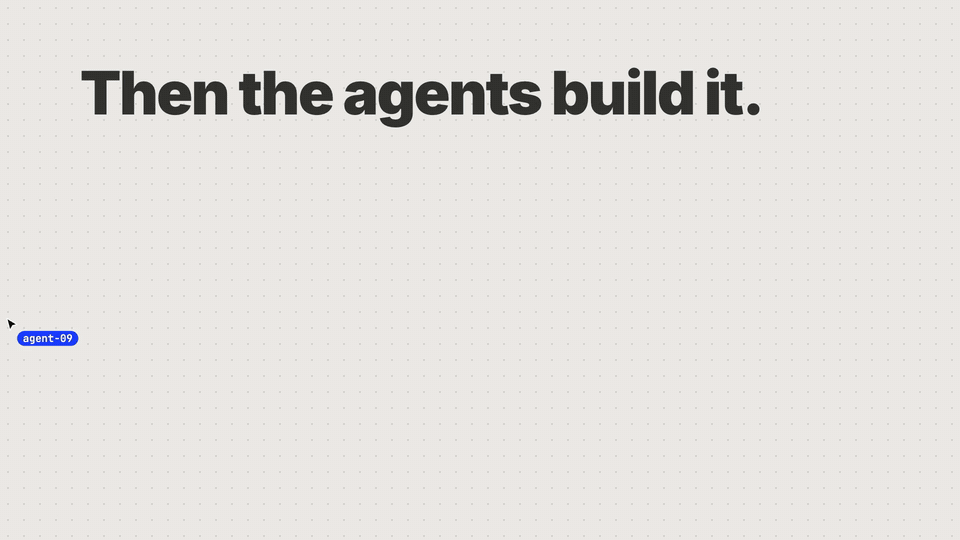

# agent-swarm-effect

[](https://www.npmjs.com/package/agent-swarm-effect)
[](https://www.npmjs.com/package/agent-swarm-effect)
[](https://www.npmjs.com/package/agent-swarm-effect?activeTab=code)
[](LICENSE)

**A crew of cursor agents for every div.** Wrap any element and a swarm of agents flies in to build it: one drags out the frame, a scan line sweeps it, another boxes each piece of text, and an I-beam types the text in, one character at a time. Then they leave.

<p align="center">
  
</p>

<p align="center">
  <a href="https://zadescoxp.github.io/agent-swarm-effect/"><b>Website</b></a> ·
  <a href="https://zadescoxp.github.io/agent-swarm-effect/#docs"><b>Docs</b></a> ·
  <a href="https://zadescoxp.github.io/agent-swarm-effect/#examples"><b>Live examples</b></a> ·
  <a href="https://www.npmjs.com/package/agent-swarm-effect"><b>npm</b></a>
</p>

## Install

```bash
npm i agent-swarm-effect
```

Also works with `pnpm add`, `yarn add` and `bun add`.

## Quick start

```tsx
import { Swarm } from "agent-swarm-effect";

export default function Page() {
  return (
    <Swarm>
      <div>this is a div</div>
    </Swarm>
  );
}
```

That's the whole setup. Every direct child of `<Swarm>` gets its own frame, and its text gets typed in as it scrolls into view.

To choose the parts yourself, mark them with `data-swarm`. The value becomes the frame's label:

```tsx
<Swarm>
  <article data-swarm="Card">
    <h3 data-swarm="Name">Ada Okafor</h3>
    <p data-swarm="Role">Design engineer</p>
    <button data-swarm="Button">Follow</button>
  </article>
</Swarm>
```

## Why it's nice

- **One component.** `<Swarm>` around anything. No config, no CSS to import.
- **Real typing, real kerning.** Text is hidden with the CSS Custom Highlight API instead of being split into spans, so your fonts, wrapping and ligatures stay exactly as designed.
- **Light.** About 6 kB gzipped, zero dependencies. One shared canvas, and nothing runs while nothing is being built.
- **Works anywhere.** React 17+, Next.js (ships with `"use client"`, no flash before hydration), Vite, or no framework at all.
- **Polite.** The canvas ignores clicks and is hidden from screen readers, text stays in the DOM, and people who prefer reduced motion get the finished page straight away.

## Docs

The full docs, with live examples you can replay, are at **[zadescoxp.github.io/agent-swarm-effect](https://zadescoxp.github.io/agent-swarm-effect/#docs)**. The essentials:

### Props

| Prop | Type | Default | What it does |
| --- | --- | --- | --- |
| `selector` | `string` | `[data-swarm]`, else children | Which elements get built. |
| `trigger` | `"visible" \| "mount" \| "manual"` | `"visible"` | Build on scroll, on mount, or when you call `play()`. |
| `speed` | `number` | `1` | Playback speed. `2` is twice as fast. |
| `theme` | `"auto" \| "light" \| "dark" \| { ink, paper, accent }` | `"auto"` | `auto` reads the background behind each frame. Pass colours to match your brand. |
| `labels` | `boolean` | `true` | The `Label  W×H` tag on each frame. |
| `names` | `boolean` | `true` | The name tag next to each cursor. |
| `namePrefix` | `string` | `"agent"` | Agents are called `agent-01`, `agent-02`… |
| `scan` | `boolean` | `true` | Scan line over taller elements. |
| `typing` | `boolean` | `true` | Type text in. When `false`, text appears with its frame. |
| `font` | `string` | system mono | CSS font shorthand for tags and labels. |
| `respectReducedMotion` | `boolean` | `true` | Skip the effect for reduced-motion users. |
| `rootMargin` | `string` | `"0px 0px -6% 0px"` | Margin for the `visible` trigger. |
| `onStart`, `onComplete` | `() => void` | | Called when building starts and when everything is built. |
| `as` | `ElementType` | `"div"` | The wrapper element. Other props pass straight through. |

### Data attributes

| Attribute | What it does |
| --- | --- |
| `data-swarm="Label"` | Build this element as its own frame. |
| `data-swarm-label="Label"` | Rename a frame without marking it. |
| `data-swarm-skip` | Don't type the text inside. It appears with its frame. |
| `data-swarm-state` | Set by the library (`pending`, `built`, `done`), handy for your own styles. |

### Replay and manual control

```tsx
import { Swarm, type SwarmHandle } from "agent-swarm-effect";

const swarm = useRef<SwarmHandle>(null);

<Swarm ref={swarm} trigger="manual">
  <Hero />
</Swarm>

swarm.current?.play();    // start
swarm.current?.replay();  // hide everything and build it again
swarm.current?.reveal();  // skip to the end
```

### Without a wrapper: `useSwarm`

```tsx
import { useSwarm } from "agent-swarm-effect";

function Card() {
  const ref = useRef<HTMLDivElement>(null);
  const swarm = useSwarm(ref, { speed: 1.5, labels: false });
  return <div ref={ref} onClick={() => swarm.replay()}>…</div>;
}
```

### Without React: vanilla JS

Works with Vue, Svelte, Astro or a plain HTML page.

```js
import { createSwarm } from "agent-swarm-effect/vanilla";

const swarm = createSwarm(document.querySelector("main"), {
  selector: "section, h1, p",
  theme: { ink: "#1b3dff", paper: "#fff", accent: "#1b3dff" },
});
```

## Browser support

Every evergreen browser. Character-by-character typing uses the CSS Custom Highlight API (Chrome 105+, Safari 17.2+, Firefox 140+). Where it isn't available, text appears whole when its typist reaches it.

## Contributing

Issues and pull requests are welcome. To work on it locally:

```bash
git clone https://github.com/zadescoxp/agent-swarm-effect.git
cd agent-swarm-effect
npm install
npm run dev
```

That builds the library and starts the docs site on `http://localhost:5178`. The library lives in [`packages/agent-swarm-effect`](packages/agent-swarm-effect) and the site in [`site`](site).

If you like it, a ⭐ helps other people find it.

## License

MIT © [Zade](https://zadescoxp.com)
